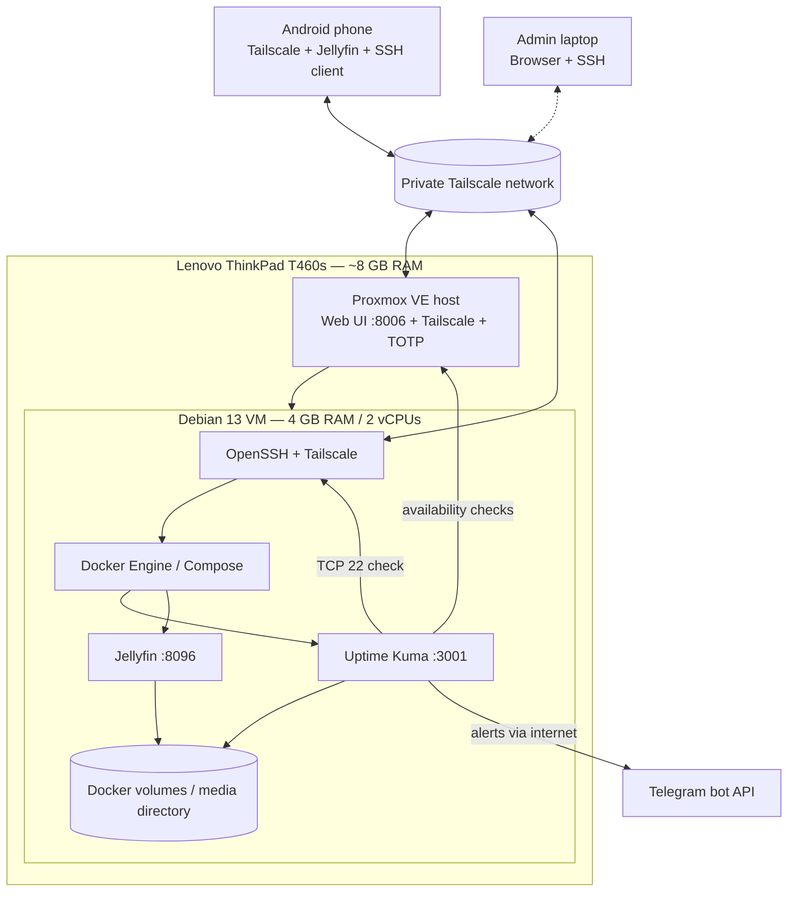

# Proxmox Home Server Lab

> Repurposing a Lenovo ThinkPad into a small, remotely managed self-hosting lab — a practical portfolio project in Linux administration, virtualization, containerization, networking, and security.

**Project status:** Active homelab · **Documented:** November 2026 · **Deployment:** On-premises, single physical host

## Overview

I built this home server using an older **Lenovo ThinkPad T460s** rather than dedicated server hardware. **Proxmox VE** runs on the laptop, with a **Debian 13** virtual machine hosting Docker applications. The lab provides service monitoring, mobile notifications, a personal media library, and private remote access.

This repository documents the work completed, shows reproducible *example* configuration, explains design decisions, and records real troubleshooting cases. It does **not** contain a live infrastructure export, production secrets, or private media.

## What works today

| Layer | Implementation | Outcome |
| --- | --- | --- |
| Hardware | Lenovo ThinkPad T460s, ~8 GB host RAM, 256 GB SSD | Repurposed hardware |
| Virtualization | Proxmox VE | Web-managed VM platform |
| Guest OS | Debian GNU/Linux 13, 4 GB VM RAM, 2 vCPUs | Headless Linux server |
| Guest integration | QEMU Guest Agent | Guest-aware host integration |
| Remote administration | OpenSSH | CLI administration from another machine |
| Containers | Docker Engine + Docker Compose | Reproducible application deployment |
| Monitoring | Uptime Kuma v2 | TCP checks of Proxmox management and Debian SSH |
| Notifications | Telegram bot integration | Tested service alert delivery |
| Private access | Tailscale on Proxmox, Debian, and Android | Remote dashboard / SSH access over mobile data |
| Access protection | Proxmox TOTP two-factor authentication | Additional sign-in verification |
| Media streaming | Jellyfin | Movies and TV-show libraries; Android playback tested |

**Resource constraint:** The Debian VM was initially allocated 2 GB RAM and subsequently increased to **4 GB**. The physical host has approximately 8 GB RAM, so CPU, memory, disk capacity, and transcoding capacity are limited. Heavy applications such as Immich are *not* listed as completed deployments.

## Architecture



*Diagram is conceptual. Tailscale runs on both Proxmox and the Debian VM. Uptime Kuma monitors **ports**, not complete host health. If the VM hosting Uptime Kuma is offline, its internal monitor cannot independently report that outage.*

## Repository layout

```text
proxmox-homelab/
├── README.md
├── SECURITY.md
├── .gitignore
├── docs/
│   ├── 01-hardware-and-proxmox.md
│   ├── 02-debian-vm-setup.md
│   ├── 03-ssh-administration.md
│   ├── 04-docker-and-compose.md
│   ├── 05-uptime-kuma-and-telegram.md
│   ├── 06-tailscale-remote-access.md
│   ├── 07-jellyfin-media-server.md
│   ├── 08-security-hardening.md
│   ├── 09-troubleshooting.md
│   ├── 10-operations-and-backups.md
│   └── 11-roadmap.md
├── docker/
│   ├── uptime-kuma/compose.yaml
│   └── jellyfin/compose.yaml
├── diagrams/architecture.md
└── screenshots/README.md
```

## Documentation guide

| Area | Guide |
| --- | --- |
| Physical hardware and hypervisor | [Hardware and Proxmox](docs/01-hardware-and-proxmox.md) |
| VM setup and resource allocation | [Debian VM](docs/02-debian-vm-setup.md) |
| Secure remote shell access | [SSH administration](docs/03-ssh-administration.md) |
| Container installation and management | [Docker and Compose](docs/04-docker-and-compose.md) |
| Monitoring and alerts | [Uptime Kuma + Telegram](docs/05-uptime-kuma-and-telegram.md) |
| Remote private networking | [Tailscale](docs/06-tailscale-remote-access.md) |
| Self-hosted media streaming | [Jellyfin](docs/07-jellyfin-media-server.md) |
| Identity and network security | [Security hardening](docs/08-security-hardening.md) |
| Problems solved during the build | [Troubleshooting](docs/09-troubleshooting.md) |
| Maintenance and backup planning | [Operations and backups](docs/10-operations-and-backups.md) |
| Future engineering work | [Roadmap](docs/11-roadmap.md) |

## Key design decisions

1. **Hypervisor first:** Proxmox separates the physical host from its guest workloads, making VM operations easier to manage.
2. **Headless Debian guest:** Avoids desktop-environment overhead on constrained hardware.
3. **Compose files for services:** Service definitions are easier to read, update, and recreate than undocumented `docker run` commands.
4. **No router port forwarding for administration:** Tailscale supplies private device-to-device connectivity to both Proxmox and Debian.
5. **Two-factor authentication on Proxmox:** Reduces exposure from password compromise.
6. **Service-level alerts:** Uptime Kuma provides a lightweight view of availability. An external monitor would still be needed to detect a complete VM/host outage.
7. **Direct media playback where possible:** Avoids resource-intensive Jellyfin transcoding on a 2-vCPU guest.

## Quick verification commands

On the Debian guest:

```bash
hostname -I
free -h
nproc
systemctl is-active ssh
docker --version
docker compose version
docker ps
docker stats --no-stream
tailscale status
```

For sample application definitions, see [`docker/`](docker/). Set the service bind address as described in the [Compose guide](docs/04-docker-and-compose.md), then review media paths and UID/GID before deployment. **Do not run samples blindly on a system with existing containers:** review the files and reconcile them with your actual running configuration.

## Evidence and screenshots

See [`screenshots/README.md`](screenshots/README.md) for an evidence checklist and privacy guidelines. This public repository intentionally contains **no screenshots of private media, secrets, authentication tokens, or private addresses**.

## Skills demonstrated

- Virtualization and provisioning with Proxmox VE
- Linux installation, headless administration, SSH and troubleshooting
- Docker image / container lifecycle and Compose deployments
- Basic TCP/HTTP service monitoring and alert integrations
- Private overlay networking with Tailscale
- Two-factor authentication and reducing attack surface
- File synchronization via SCP/rsync for media ingestion
- Capacity planning and operational documentation

## Resume-ready description

**Self-Hosted Infrastructure & DevOps Homelab — Personal Project**

- Built a Proxmox-based homelab on repurposed laptop hardware and provisioned a headless Debian 13 VM with guest integration and remote SSH administration.
- Deployed and maintained containerized Uptime Kuma and Jellyfin applications using Docker Compose, persistent storage, and service verification.
- Configured private remote access with Tailscale on both the hypervisor and guest, plus TOTP authentication for Proxmox administrative access.
- Implemented service availability checks and tested Telegram alerting; documented troubleshooting, resource constraints, and operational safeguards.

## Scope and next steps

**Completed:** the components in the table above. **Not yet implemented or validated:** automated off-host backups, infrastructure-as-code, HA, advanced observability, public reverse proxy, Immich, or automated restore drills. Those are proposals documented in the [roadmap](docs/11-roadmap.md).

## References

- [Proxmox VE documentation](https://pve.proxmox.com/pve-docs/)
- [Debian documentation](https://www.debian.org/doc/)
- [Docker Engine for Debian](https://docs.docker.com/engine/install/debian/)
- [Docker Compose documentation](https://docs.docker.com/compose/)
- [Uptime Kuma project](https://github.com/louislam/uptime-kuma)
- [Tailscale documentation](https://tailscale.com/kb/)
- [Jellyfin Docker installation](https://jellyfin.org/docs/general/installation/container/)

**Licensing:** No license has been selected yet; choose one before inviting reuse or contributions. Third-party applications remain subject to their own licenses.
