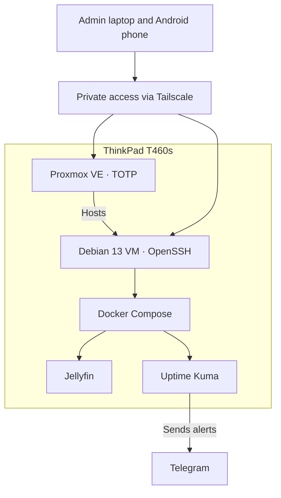

# Proxmox Home Server Lab

**A retired ThinkPad, repurposed as a home server.**

I run Proxmox VE on a ThinkPad T460s and host my applications in a Debian 13 VM. The lab streams media with Jellyfin, monitors service availability with Uptime Kuma, and uses Tailscale for private access away from home.

[Architecture](#architecture) · [Build guide](#build-guide) · [Compose examples](#compose-examples) · [Roadmap](docs/11-roadmap.md)

---

## The lab at a glance

| Layer | What runs here |
| --- | --- |
| **Host** | ThinkPad T460s · ~8 GB RAM · 256 GB SSD · Proxmox VE |
| **Guest** | Debian 13 · 4 GB RAM · 2 vCPUs · QEMU Guest Agent |
| **Applications** | Docker Compose · Jellyfin media streaming · Uptime Kuma with Telegram alerts |
| **Administration** | OpenSSH · Tailscale private access · Proxmox TOTP |

## Architecture

Uptime Kuma checks the Proxmox management endpoint and Debian SSH. Because it runs inside the lab, it shares the host’s failure domain. [Detailed architecture and trust boundaries](diagrams/architecture.md)

## Build guide

| Stage | What it covers |
| --- | --- |
| **Provision the host** | [Hardware and Proxmox](docs/01-hardware-and-proxmox.md) · [Debian guest](docs/02-debian-vm-setup.md) |
| **Set up access** | [SSH administration](docs/03-ssh-administration.md) · [Tailscale](docs/06-tailscale-remote-access.md) · [Security hardening](docs/08-security-hardening.md) |
| **Deploy services** | [Docker and Compose](docs/04-docker-and-compose.md) · [Uptime Kuma and Telegram](docs/05-uptime-kuma-and-telegram.md) · [Jellyfin](docs/07-jellyfin-media-server.md) |
| **Operate the lab** | [Troubleshooting log](docs/09-troubleshooting.md) · [Maintenance and backup planning](docs/10-operations-and-backups.md) |

### Compose examples

| Service | Template | Persistent storage |
| --- | --- | --- |
| **Uptime Kuma** | [compose.yaml](docker/uptime-kuma/compose.yaml) | Docker volume for application state |
| **Jellyfin** | [compose.yaml](docker/jellyfin/compose.yaml) | Local config and cache directories, plus a read-only media mount |

Before starting either example, set `HOMELAB_BIND_IP` in the service’s local `.env` file. Review Jellyfin’s media paths and UID/GID and reconcile the templates with any existing containers. [Compose setup guide](docs/04-docker-and-compose.md)

## Lessons from the build

- **Keep the guest lean.** A headless install leaves more memory for the applications. The VM moved from 2 GB to 4 GB RAM as the lab grew.
- **Plan for direct playback.** Compatible media formats reduce Jellyfin’s need to transcode on a 2-vCPU guest.
- **Keep administration private.** Tailscale reaches both the hypervisor and the guest without inbound router port forwarding.
- **Monitor from outside the lab for host outages.** An in-guest monitor can check service reachability while the guest is online. [Roadmap](docs/11-roadmap.md)

---

The public docs use example configurations and placeholder addresses. See the [security policy](SECURITY.md), [screenshot privacy checklist](screenshots/README.md), and [contribution and reuse notes](CONTRIBUTING.md).
