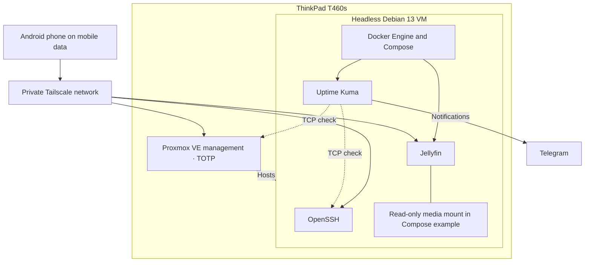

# Proxmox Home Server Lab

## Project Overview

I repurposed a Lenovo ThinkPad T460s as a Proxmox virtualization host and built a headless Debian server for media streaming, service monitoring, and private remote administration. This portfolio documents the deployment, the trade-offs of running on a single laptop, and the troubleshooting that made the services usable.

[Architecture](#infrastructure-architecture) · [Build guides](#getting-started-and-documentation) · [Troubleshooting](#challenges-and-troubleshooting) · [Video series](#video-documentation-series)

## Key Features

| Capability | Implemented and verified |
| --- | --- |
| Virtualized server | Headless Debian 13 guest with QEMU Guest Agent and SSH administration |
| Containerized services | Separate Docker Compose deployments for Uptime Kuma and Jellyfin |
| Availability alerts | TCP checks for Proxmox management and Debian SSH, with tested Telegram delivery |
| Private administration | Remote connectivity to Proxmox and Debian tested from Android over mobile data |
| Media streaming | Separate Movies and Shows libraries with remote playback tested in the Jellyfin Android app |

## Infrastructure Architecture



The hypervisor handles virtualization and management. The Debian guest runs the applications. Both have their own Tailscale installation. [Detailed architecture and trust boundaries](diagrams/architecture.md)

## Hardware and Software Stack

| Layer | Configuration |
| --- | --- |
| Physical host | Lenovo ThinkPad T460s, approximately 8 GB RAM, 256 GB SSD |
| Hypervisor | Proxmox VE installed directly on the laptop |
| Guest | Debian 13, 4 GB RAM, 2 vCPUs, approximately 116 GB system filesystem |
| Guest integration and administration | QEMU Guest Agent, OpenSSH |
| Container runtime and services | Docker Engine, Docker Compose, Uptime Kuma, Jellyfin |
| Remote access and notifications | Tailscale on Proxmox, Debian, and Android, plus Telegram for alerts |

The VM grew from 2 GB to 4 GB RAM. I kept Debian headless and favored direct playback to reduce the CPU cost of Jellyfin transcoding.

## Implementation and Deployment

1. Installed Proxmox VE on the ThinkPad, provisioned the Debian VM, and configured QEMU Guest Agent.
2. Configured SSH for remote administration and installed Docker Engine and the Compose plugin.
3. Deployed Uptime Kuma with persistent state, configured the two TCP monitors, and tested Telegram delivery.
4. Enrolled Proxmox, Debian, and Android in Tailscale, tested access over mobile data, and enabled TOTP on Proxmox.
5. Deployed Jellyfin with Compose, transferred personal media from another computer, and configured separate Movies and Shows libraries. Installed the Jellyfin Android app and tested playback over Tailscale.

## Security Measures

- **Private management access.** Tailscale provides the remote network path to Proxmox and Debian without public router port forwarding.
- **Additional authentication.** Proxmox requires TOTP for the configured account. Application authentication, access policies, and service bindings still need their own controls.
- **Explicit bindings in the samples.** Both public Compose examples require `HOMELAB_BIND_IP` in an ignored local `.env`. Select the appropriate trusted interface or loopback and review the host firewall.
- **Privileged Docker administration.** Direct Docker access was granted to a trusted administrative user. The Docker group is root-equivalent on the guest.

[Security hardening](docs/08-security-hardening.md) · [Repository security policy](SECURITY.md)

## Monitoring and Alerting

| Monitor | Check | What the result indicates |
| --- | --- | --- |
| Proxmox management | TCP connection to the management port | The management endpoint accepts a connection |
| Debian SSH | TCP connection to the SSH port | The SSH endpoint accepts a connection |
| Telegram delivery | Uptime Kuma test notification | A test message reached the configured chat |

TCP checks establish endpoint reachability. They do not test authentication or application health. Uptime Kuma runs inside the Debian guest and cannot reliably report a full host or guest outage. [Monitoring and Telegram setup](docs/05-uptime-kuma-and-telegram.md)

## Challenges and Troubleshooting

| Problem | Diagnosis | Resolution | Lesson learned |
| --- | --- | --- | --- |
| SSH to Debian timed out | The previously used VM address was stale | Retrieved the current address from the VM console and reconnected | Verify the destination before changing SSH settings |
| Docker initially required `sudo` | The administrative account lacked Docker socket access | Added the trusted administrator to the Docker group and reconnected to refresh membership | Docker group membership grants root-equivalent access |
| Telegram test returned HTTP 400 | The notification request was rejected. The exact configuration fault was unconfirmed | Corrected the bot notification configuration and verified message delivery | Test delivery end to end and keep tokens out of diagnostics |
| Needed access from outside the LAN | Proxmox and Debian needed a private remote network path | Installed Tailscale on the host, VM, and Android phone and tested over mobile data | Test remote access with Wi-Fi off |
| Movies were absent from Jellyfin | Files existed. Container mounts, file visibility, and library paths needed checking | Verified the mounts and in-container files, checked library paths, and rescanned | Check each step from host storage to the application library |
| Remote `rsync` transfer failed | The Debian receiver lacked `rsync` | Installed `rsync` on Debian and retried | Remote-shell transfers require `rsync` at both ends |

[Full troubleshooting log and diagnostic commands](docs/09-troubleshooting.md)

## Video Documentation Series

I documented the build through practical educational videos covering setup, configuration, deployment, troubleshooting, and security. The demonstrations show how I explain infrastructure decisions, walk through configuration, and share what I learned during the build.

The parts are published individually on [Instagram](https://www.instagram.com/change_kelvinm/) and [TikTok](https://www.tiktok.com/@change_kelvin). Browse the profiles for the individual posts.

| Parts | Topics |
| --- | --- |
| 1–3 | Early homelab setup and preparation |
| 4–6 | Proxmox, Debian VM setup, and server configuration |
| 7 | SSH configuration and remote administration |
| 8 | Installing Docker Engine and Docker Compose |
| 9 | Deploying Uptime Kuma and configuring Telegram alerts |
| 10 | Configuring Tailscale for private remote access and enabling Proxmox 2FA |
| 11 | Deploying Jellyfin and configuring personal media streaming |

## Screenshots and Demonstrations

All seven screenshot slots are pending. The video series above provides the published demonstrations.

| Planned capture | What it will show |
| --- | --- |
| Proxmox dashboard | Hypervisor overview and guest status |
| Debian VM configuration | Assigned RAM and vCPUs |
| Running Docker containers | Uptime Kuma and Jellyfin container status |
| Uptime Kuma dashboard | Availability checks with generic labels |
| Tailscale connectivity | Connected device roles with identifiers removed |
| Jellyfin media library | Movies and Shows library structure using an empty or demo view |
| Remote access | Successful access from Android on mobile data |

[Capture and sanitization guide](screenshots/README.md)

## Key Skills Demonstrated

| Skill | Project evidence |
| --- | --- |
| Linux system administration | Ran Debian headless, verified services, diagnosed missing packages, and transferred media |
| Virtualization | Installed Proxmox on physical hardware, sized a Debian VM, and configured guest integration |
| TCP/IP networking and SSH | Diagnosed a stale address, restored SSH connectivity, and monitored TCP endpoints |
| Docker and Docker Compose | Deployed two services, managed persistent storage, and verified media visibility inside a container |
| Monitoring and alerting | Configured two availability checks and confirmed Telegram delivery |
| VPN-based access and authentication | Tested Tailscale access over mobile data, enabled Proxmox TOTP, and documented Docker group privileges |
| Infrastructure troubleshooting | Traced failures across the network, permissions, notification configuration, and storage |
| Technical writing and communication | Wrote build and troubleshooting guides and recorded an educational series explaining the implementation |

## Future Improvements

| Horizon | Planned work |
| --- | --- |
| Near-term | Automate backups, verify whether a Jellyfin monitor exists and add one if needed, track disk and resource usage, and improve media storage organization |
| Intermediate | Use Ansible for configuration management, define a container update and rollback strategy, test backup restores, and centralize logs |
| Long-term | Introduce infrastructure as code and CI/CD for deployment configuration, evaluate additional self-hosted apps, document disaster recovery, and segment the network |

[Detailed roadmap and completed milestones](docs/11-roadmap.md)

## Getting Started and Documentation

| Stage | Guides |
| --- | --- |
| Provision | [Hardware and Proxmox](docs/01-hardware-and-proxmox.md) · [Debian VM](docs/02-debian-vm-setup.md) |
| Configure access | [SSH](docs/03-ssh-administration.md) · [Tailscale](docs/06-tailscale-remote-access.md) · [Security](docs/08-security-hardening.md) |
| Deploy services | [Docker and Compose](docs/04-docker-and-compose.md) · [Uptime Kuma and Telegram](docs/05-uptime-kuma-and-telegram.md) · [Jellyfin](docs/07-jellyfin-media-server.md) |
| Operate | [Troubleshooting](docs/09-troubleshooting.md) · [Maintenance and backups](docs/10-operations-and-backups.md) |

Start with the provisioning and access guides, then review the [Uptime Kuma Compose example](docker/uptime-kuma/compose.yaml) and [Jellyfin Compose example](docker/jellyfin/compose.yaml). Set the bind address for each service, review Jellyfin’s media paths and UID/GID, and reconcile the examples with any existing containers. [Contribution and reuse notes](CONTRIBUTING.md)

<details>
<summary>Quick verification commands for the Debian guest</summary>

```bash
hostname -I
free -h
nproc
systemctl is-active ssh
docker --version
docker compose version
docker ps
docker stats --no-stream
tailscale status
```

Run these locally. Review IP addresses, device names, and account details before sharing any output.

</details>

## Resume Project Summary

**Self-Hosted Infrastructure and DevOps Homelab**

**Technologies** · Proxmox VE, Debian Linux, Docker, Docker Compose, Tailscale, SSH, Uptime Kuma, Jellyfin

- Provisioned a headless Debian 13 VM on a repurposed ThinkPad running Proxmox VE and configured SSH administration and QEMU Guest Agent.
- Deployed Uptime Kuma and Jellyfin with Docker Compose, verified Telegram alerts for service monitoring, and tested Jellyfin playback from Android.
- Configured private Tailscale access to the hypervisor and guest, validated connectivity over mobile data, and enabled Proxmox TOTP.
- Documented deployment and troubleshooting in public build guides and an educational video series on Instagram and TikTok.
