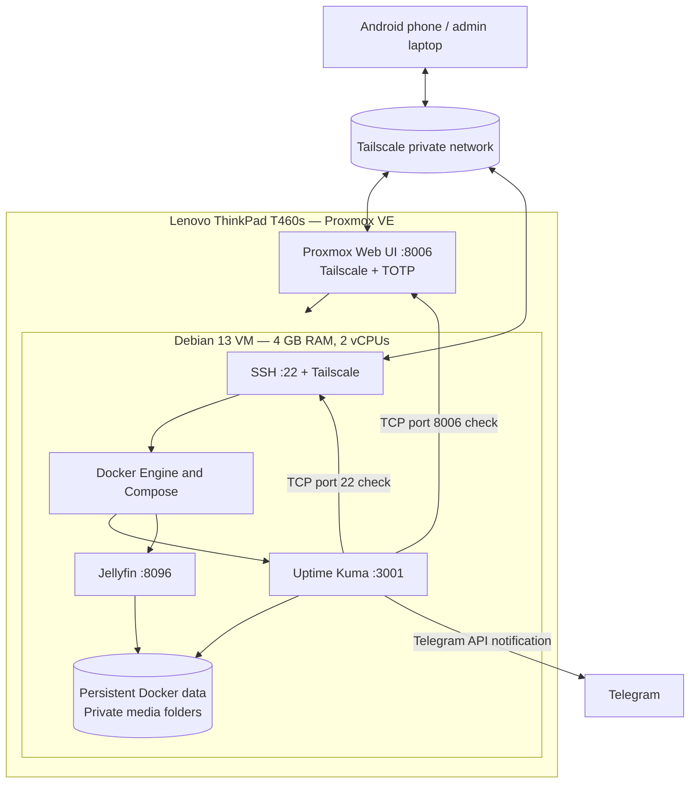

# Architecture diagram

## Trust boundaries

- The **Proxmox host** is the virtualization management plane.
- The **Debian guest** is the container/application plane.
- **Tailscale** provides private overlay connectivity to both nodes; it does not by itself make an application secure.
- **Docker published ports** are available on the guest's bound interfaces; do not assume they are automatically restricted to Tailscale.
- **Uptime Kuma** monitors selected service endpoints and depends on the same guest it monitors.

## Status

This represents deployed components reported during the project, not planned services such as Immich or off-host backups.
